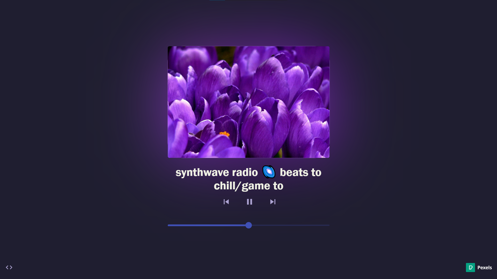
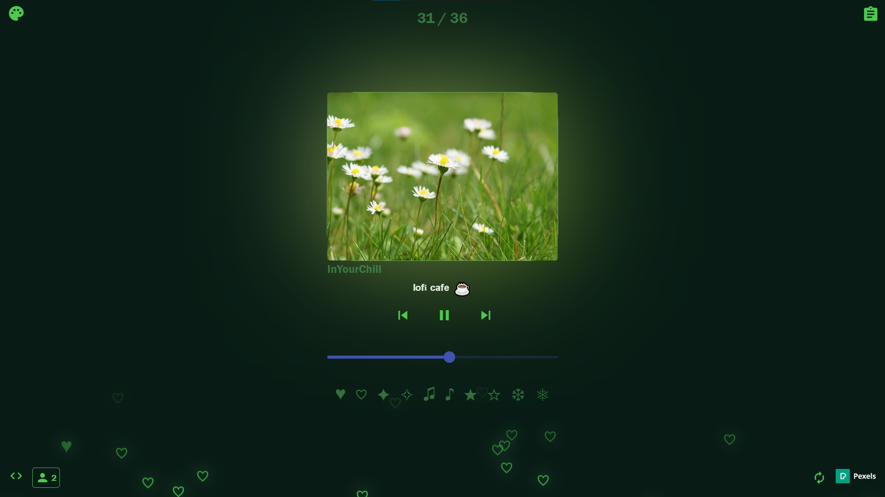
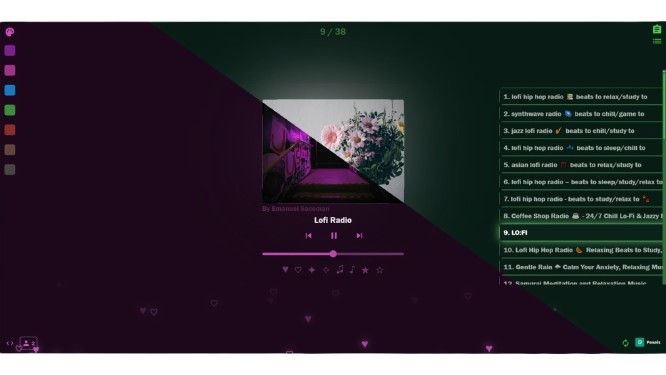
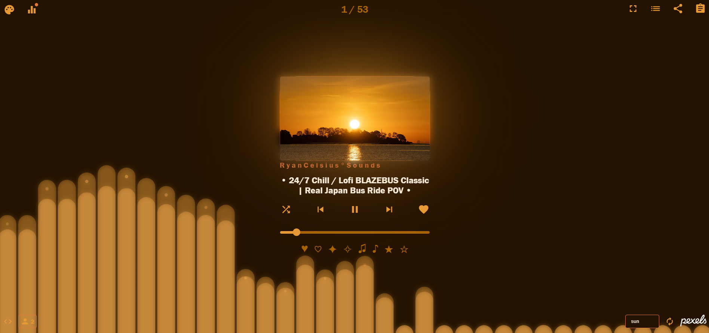

# 📼 Lofi Radio

Faz tempo que queria fazer algo assim... Um site com algumas estações de rádio 24/7 de puro **LOFI**! Aproveitem. 🎶

A primeira versão deste projeto foi feita em apenas **2 dias** — fruto do entusiasmo e vontade de criar algo próprio.  
Esse entusiasmo continua vivo, e novas atualizações estão a caminho! 🌱

---

## 📌 Última Atualização – Melhorias de Qualidade de Vida

A versão mais recente do site trouxe uma série de melhorias pensadas para tornar a experiência mais agradável e flexível, tanto para mim quanto para os usuários:

### 🔐 Modo ADM (Acesso Exclusivo)
- Criação de um painel administrativo oculto, acessível apenas por mim.
- Permite **adicionar** ou **remover** rádios sem necessidade de editar o código-fonte.

### 🎨 Personalização do Tema
- Os usuários agora podem:
  - Escolher **paletas de cores** para o site.
  - Selecionar diferentes **wallpapers de fundo**.

### 👥 Contador de Usuários Online
- Agora é possível visualizar **quantas pessoas estão no site em tempo real**.
- Tudo isso de forma **anônima**, sem necessidade de login.

### 😄 Emojis Interativos
- Emojis flutuantes que os usuários podem clicar.
- O emoji clicado é enviado ao banco de dados e reaparece no site como um **popup** visível a todos os usuários conectados.

### 📻 Contador de Rádios
- Um contador no topo da página indica o número total de rádios disponíveis.

### 📡 Efeito Sonoro ao Trocar de Rádio
- Ao trocar de estação, um **leve som de chiado** é reproduzido.
- Cria uma experiência mais **imersiva**, como se fosse uma rádio de verdade.

---

---

## 🚀 Última Atualização – Abril 2025

O projeto **Lofi Radio** recebeu mais uma grande atualização, recheada de melhorias que elevam ainda mais a experiência do usuário!  
Talvez essa seja a **última atualização oficial** — então aproveita que ficou massa demais! 🤯

### ✨ Novidades e Melhorias

- **📃 Listagem de Rádios Disponíveis**
  - Agora é possível visualizar todas as rádios ativas em tempo real, graças à integração com a **YouTube Data API v3**.

- **🎚️ Cor na Barra de Volume**
  - A barra de volume agora respeita o tema escolhido!
  - Como o Angular Material não permitia essa personalização diretamente, reescrevi tudo com **CSS puro e coragem**.

- **🌗 Transição Suave entre Temas**
  - A troca de temas está muito mais fluida e com transições visuais suaves.
  - Removi essa funcionalidade da versão mobile para garantir **maior performance**.

- **🛠️ Painel do Administrador Aprimorado**
  - O modo ADM agora exibe informações detalhadas sobre o uso da API.
  - Caso ocorra um erro 403 (limite de cotas da API), os usuários são **automaticamente notificados**.

- **📡 Status das Rádios**
  - Se alguma rádio estiver fora do ar, o site informa em tempo real, evitando confusão.

- **👥 Contador de Usuários**
  - O contador de usuários online está mais **preciso, responsivo e eficiente**.

- **📦 Otimização da Estrutura dos Scripts**
  - Refatorei partes do código para melhorar a **performance, manutenção e legibilidade**.

---

---

Se curtir o projeto, não esqueça de deixar uma ⭐ aqui no repositório!  
Obrigado por ouvir! ☕🎧

# 📼 Lofi Radio

**Sua trilha sonora 24/7 para estudar, programar, trabalhar ou simplesmente relaxar.** ☕🎧

O **Lofi Radio** é uma aplicação web que reúne estações de rádio LOFI, personalização visual, interações em tempo real e visualizadores de áudio em uma experiência imersiva.

🎧 **[Ouvir agora](https://lofiradio.web.app/)** 

---

## ☕ Sobre o projeto

Fazia tempo que eu queria criar um lugar onde pudesse simplesmente abrir uma página, escolher uma estação LOFI e deixar a música tocando enquanto faço minhas coisas.

Foi assim que nasceu o **Lofi Radio**.

A primeira versão foi desenvolvida em apenas **2 dias**, movida pela vontade de transformar uma ideia pessoal em algo funcional.

O que começou como um player simples evoluiu para uma aplicação com integrações externas, funcionalidades em tempo real, personalização e efeitos visuais que reagem à música.

E o melhor: tudo isso diretamente no navegador, sem precisar criar uma conta para ouvir.

## ✨ Funcionalidades

### 📻 Rádios e reprodução

- **Estações LOFI 24/7:** transmissões integradas ao YouTube.
- **Lista de rádios:** navegação entre as estações disponíveis.
- **Rádios favoritas:** marque suas estações preferidas.
- **Controles de reprodução:** play, pause, próxima, anterior e reprodução aleatória.
- **Controle de volume:** barra personalizada que acompanha a paleta selecionada.
- **Status das transmissões:** identificação de rádios indisponíveis e tratamento de falhas.
- **Novas estações:** indicadores visuais para novidades no catálogo.
- **Efeito de sintonia:** chiado ao trocar de rádio, simulando uma experiência analógica.

### 🎨 Personalização e atmosfera

- **Paletas de cores:** personalize a aparência da interface.
- **Wallpapers dinâmicos:** imagens integradas à API do Pexels.
- **Busca de imagens:** encontre fundos de acordo com o ambiente desejado.
- **Transições visuais:** mudanças suaves entre os temas.
- **Modo tela cheia:** experiência com menos distrações.
- **Efeito VHS:** estética visual inspirada em mídias analógicas.

### 🌊 Visualizadores de áudio

Uma das maiores evoluções do projeto foi a implementação de visualizadores procedurais, desenhados com **Canvas 2D** e conectados à **Web Audio API**.

Os efeitos podem reagir à intensidade, às frequências e às variações da música.

Entre os estilos disponíveis para criação estão:

- **Waves:** ondas e curvas que acompanham o comportamento do áudio.
- **Equalizer:** barras que respondem às diferentes bandas de frequência.
- **Fireflies:** vaga-lumes animados com movimento, brilho e piscadas individuais.

Os visualizadores possuem parâmetros configuráveis, como cores, intensidade, escala, composição e resposta sonora.

**Como funciona:** devido às restrições de acesso ao áudio do player do YouTube, o navegador solicita autorização para compartilhar o áudio da própria aba. O processamento ocorre localmente, sem gravar ou enviar o áudio ao Firebase.

A captura é iniciada somente após a escolha explícita de um visualizador. O funcionamento depende do suporte do navegador, sendo voltado principalmente para Chrome e Edge no desktop.

### 👥 Interações em tempo real

- **Usuários conectados:** contador de ouvintes presentes no site.
- **Emojis compartilhados:** envie reações que aparecem para outros usuários conectados.
- **Experiência anônima:** não é necessário realizar login para utilizar a rádio.
- **Compartilhamento:** opção de compartilhar o Lofi Radio diretamente pelo navegador.

### 🔐 Painel administrativo

O projeto também possui uma área administrativa com acesso restrito, permitindo gerenciar funcionalidades sem alterar diretamente o código-fonte.

Entre os recursos estão:

- Gerenciamento das estações de rádio.
- Administração de temas e personalizações.
- Informações sobre a utilização da API do YouTube.
- Histórico e visualização de visitas.
- Criação e publicação de visualizadores.
- Organização dos itens disponíveis no player.

#### 🎛️ Visualizer Studio

O **Visualizer Studio** é uma interface administrativa para criar e personalizar efeitos visuais.

Ele permite configurar cores, gradientes, formas, partículas, intensidade, posicionamento e comportamento das animações.

As criações podem ser salvas como rascunho, visualizadas, editadas, duplicadas, organizadas e publicadas.

Os visualizadores publicados são disponibilizados pelo Firebase e atualizados no player em tempo real.

---

## 🛠️ Tecnologias utilizadas

| Tecnologia | Utilização |
|---|---|
| Angular 16 | Framework da aplicação |
| TypeScript | Lógica e organização do código |
| Angular Material | Componentes de interface |
| HTML, CSS e SCSS | Estrutura, estilos e responsividade |
| Firebase | Autenticação, banco de dados, funcionalidades em tempo real e hospedagem |
| YouTube Data API v3 | Informações e disponibilidade das transmissões |
| YouTube IFrame Player API | Reprodução das rádios |
| Pexels API | Busca e carregamento de wallpapers |
| Web Audio API | Análise de áudio |
| Canvas 2D | Renderização dos visualizadores |
| RxJS | Gerenciamento de fluxos assíncronos |

## 🧩 Arquitetura

A aplicação utiliza uma arquitetura baseada em componentes e serviços Angular, separando a interface, a lógica de reprodução, as integrações externas e os efeitos visuais.

Os serviços são responsáveis por funcionalidades como gerenciamento de rádios, temas, favoritos, interações, áudio e visualizadores.

O Firebase é utilizado para persistência e sincronização dos recursos que dependem de dados compartilhados, enquanto os visualizadores utilizam processamento e renderização no próprio navegador.

**Documentação técnica:**

- [Visualizadores procedurais](./docs/procedural-visualizer.md)
- [Catálogo e Visualizer Studio](./docs/visualizer-catalog.md)
- [Histórico de visitas](./docs/profile-visits.md)

---

## 📜 Evolução do projeto

O Lofi Radio começou pequeno, mas ganhou novas funcionalidades conforme surgiram ideias e oportunidades de experimentar tecnologias.

### 📼 Primeira versão

O início de tudo: uma interface simples para selecionar e ouvir estações LOFI, criada em apenas dois dias.

### 🎨 Personalização e interatividade

A aplicação passou a oferecer paletas de cores, wallpapers, contador de usuários online, emojis compartilhados e ferramentas administrativas.

### 🚀 Abril de 2025

Uma atualização importante para a experiência do usuário, incluindo melhorias na lista de rádios, integração com a YouTube Data API v3, indicadores de disponibilidade, personalização da barra de volume e otimizações internas.

### 🌊 Evolução em 2026

O projeto recebeu novas funcionalidades voltadas à experiência visual e à manutenção da aplicação, incluindo:

- Visualizadores de áudio procedurais.
- Integração com Web Audio API e Canvas.
- Visualizer Studio para criação e edição de efeitos.
- Catálogo de visualizadores gerenciado pelo Firebase.
- Melhorias no gerenciamento de rádios e favoritos.
- Novos testes automatizados e refinamentos de interface.

---

## 🤝 Contribuições e sugestões

Ideias, sugestões e melhorias são bem-vindas!

Se encontrar algum problema ou tiver uma proposta para o projeto, você pode abrir uma [issue no GitHub](https://github.com/emanuelsacoman/Lofi-Radio/issues).

## 💜 Considerações finais

O Lofi Radio é um projeto pessoal que nasceu da vontade de criar algo que eu mesmo gostaria de usar.

Mais do que uma rádio online, ele se tornou um espaço para experimentar ideias, aprender novas tecnologias e transformar música em uma experiência visual e interativa.

Se curtir o projeto, considere deixar uma ⭐ no repositório!

**Obrigado por ouvir. Agora escolha uma rádio, prepare um café e aproveite. ☕🎶**

---

Desenvolvido por [Emanuel Sacoman](https://emanuelsacoman.web.app/).

🎧 [lofiradio.web.app](https://lofiradio.web.app/)